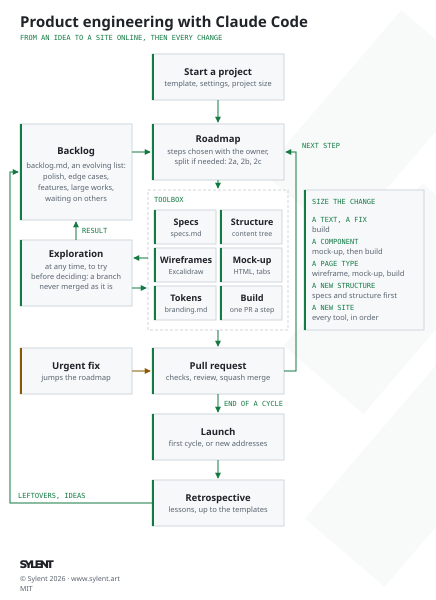

# astro-static-website-template

Template for static brand websites built with [Astro](https://astro.build/) and hosted on GitHub Pages, with the project conventions, the process from an idea to a site online, and the Claude Code setup. First used for [sylent.art](https://github.com/aunimhsn/sylent.art).

<picture>
  <source media="(prefers-color-scheme: dark)" srcset="docs/process.svg">
  
</picture>

## What it contains

| File | Content |
|---|---|
| `process.md`, `docs/process.svg`, `docs/process-light.svg` | How a site goes from an idea to online and keeps growing: a toolbox (specifications, structure, wireframes, mock-up, design system, build, launch, retrospective) picked for each change, a backlog and a roadmap, the urgent fixes and the explorations, with its diagram, dark and light (the README shows the light one, or the dark one when GitHub is in dark mode). |
| `design-journal.md` | The design experiences of past projects: choices kept and rejected, and why. A source of ideas, not rules. |
| `CLAUDE.md` | Rules for Claude Code: communication, naming, language and French typography, specifications and roadmap, Git workflow, commit messages, code review, checks, deployment. |
| `.claude/agents/code-reviewer.md` | Subagent that reviews a branch before its pull request and writes its notes, in French, to `outputs/`. |
| `.claude/agents/dependency-reviewer.md` | Subagent that reviews the open Dependabot pull requests and tells, in French, which to merge or set aside, with their links and the comments to post. |
| `.claude/skills/excalidraw-wireframes/` | Skill: editable Excalidraw wireframes and content trees, iterated with the owner. |
| `.claude/skills/html-mockups/` | Skill: the HTML mock-up built from the wireframes, styles and open decisions compared with tabs, a server without cache, then the design tokens. |
| `.claude/settings.json` | The claude.ai connectors turned off and the unused skills hidden from the model, to save tokens. |
| `specs.md`, `roadmap.md`, `backlog.md` | Skeletons of the specifications, of the roadmap (the size of the project and the steps of the first cycle) and of the backlog (polish, edge cases, features, large works, waiting on others). |
| `docs/technical-choices.md` | The stack and its reasons, the commands, the deployment, the checks. |
| `docs/branding.md` | The brand assets to ask for, then the visual identity and every design decision, with the tokens. |
| `docs/external-services.md` | The limits and terms of GitHub Pages, and the risks accepted by the owner. |
| `src/` | The Astro skeleton: base layout (metadata, favicon, Open Graph), header and footer, design tokens, home page, legal notice, not-found page, redirect page in French, `robots.txt`; French texts in `src/i18n/fr.json` and `src/content/`. |
| `src/data/urls.json` | The former addresses: kept as pages, redirected, or dropped. |
| `scripts/` | The sitemap, the checks of the addresses and of the width of every page on a phone, and the brand images (favicon, iPhone icon, preview card). |
| `.github/` | CI (`npm run check` on every pull request), deployment to GitHub Pages on every merge, Dependabot. |
| `inputs/`, `outputs/` | Untracked working folders: temporary references given to Claude Code, and temporary files it produces (see `CLAUDE.md`). |

## Start a new project

1. Create the repository from this template, with the **Use this template** button or:

   ```sh
   gh repo create <name> --template aunimhsn/astro-static-website-template --public --clone
   ```

   On a free account, the repository must be public for GitHub Pages and for the rulesets.

2. Set the pull request settings, which are not copied from the template: allow only squash merging, and delete the branches once merged:

   ```sh
   gh repo edit --enable-squash-merge --enable-merge-commit=false --enable-rebase-merge=false --delete-branch-on-merge
   ```

3. Protect `main` (**Settings › Rules › Rulesets**): require a pull request and the `check` job of CI, block force pushes and deletion.
4. In **Settings › Pages**, set the source to **GitHub Actions**. For the `github.io` preview, add the repository variables `SITE_URL` (`https://<owner>.github.io`) and `BASE_PATH` (`/<name>`) in **Settings › Secrets and variables › Actions › Variables**.
5. Fill the **Project** section of `CLAUDE.md`, the `name` of `package.json`, the `site` of `astro.config.mjs`, the texts of `src/i18n/fr.json`, and choose a port for the mock-up server in `docs/technical-choices.md` (Commands).
6. Install and check:

   ```sh
   npm install
   npx playwright install --only-shell chromium
   npm run check
   ```

7. With Claude Code, follow [process.md](process.md): size the project, then write `specs.md` (brand assets and content tree first), and split it into steps in `roadmap.md`.
8. Adapt this README to the project: keep the Requirements, Development and Deployment sections, replace the others.

## Requirements

- Node.js 24 or later (see `.nvmrc`), npm
- Python 3, for the skills (wireframes and mock-up server)
- Firefox, for the headless screenshots of the mock-up

## Development

```sh
npm run dev            # http://localhost:4321
npm run check          # format, lint, build, links and addresses, width on a phone
npm run brand:images   # favicon and preview card, from src/assets/brand/
```

Every command is described in [docs/technical-choices.md](docs/technical-choices.md#commands).

## Deployment

Every merge into `main` deploys the site to GitHub Pages (`.github/workflows/deploy.yml`). Until the launch, the site is built for its `github.io` address from the `SITE_URL` and `BASE_PATH` variables; at the launch, the custom domain is set in the Pages settings and the two variables are deleted (see [process.md](process.md#7-launch)).

## License

[MIT](LICENSE)
